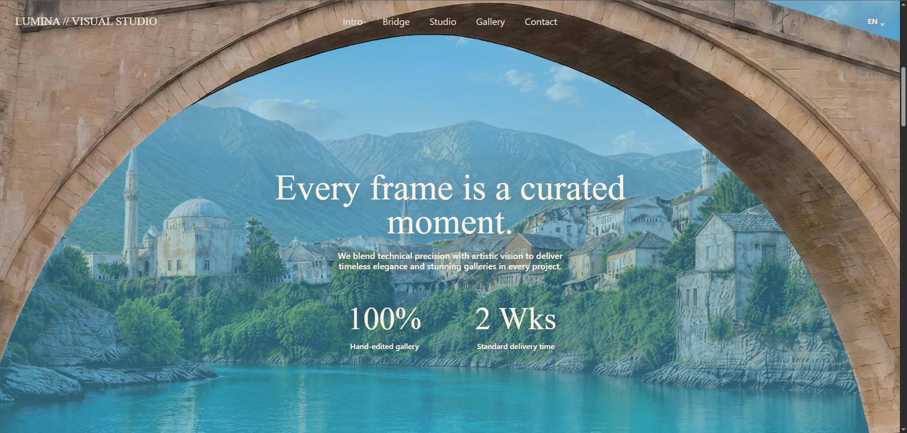
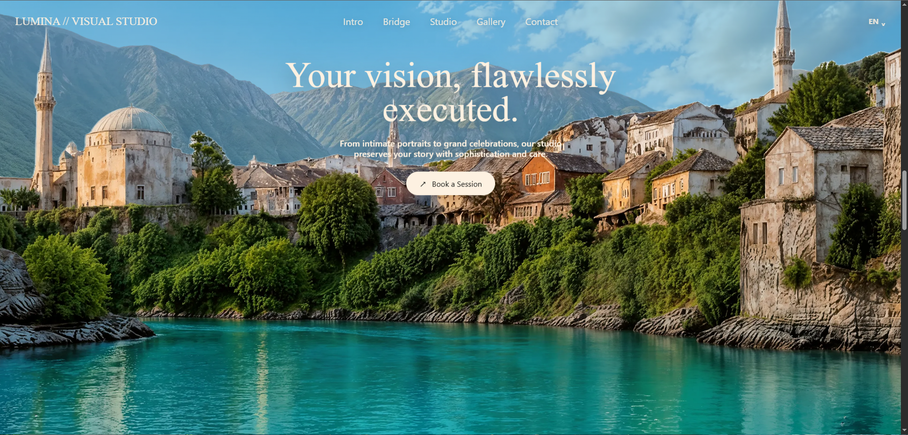
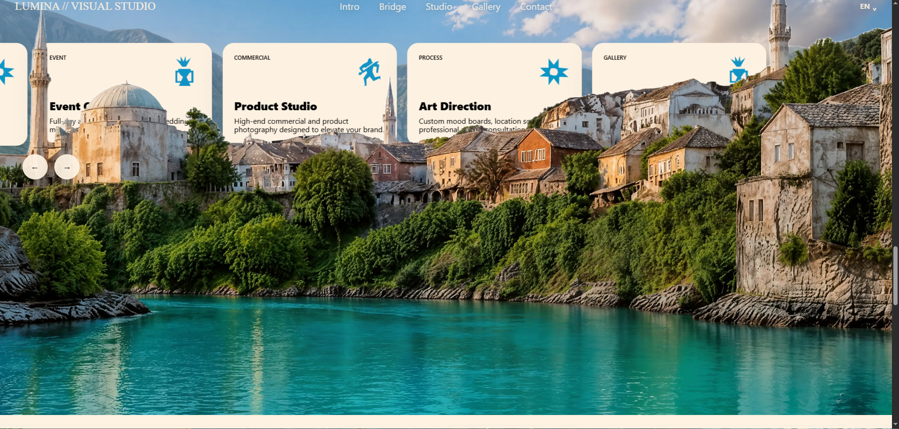
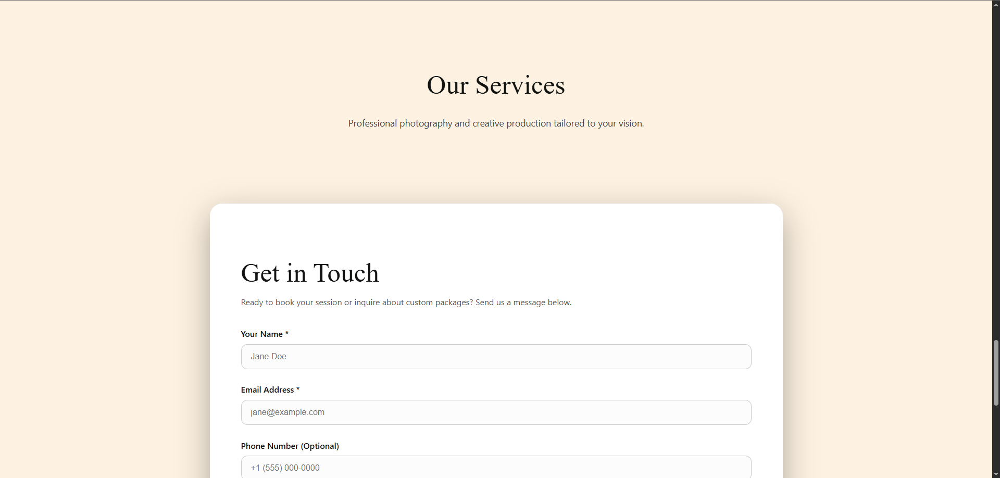
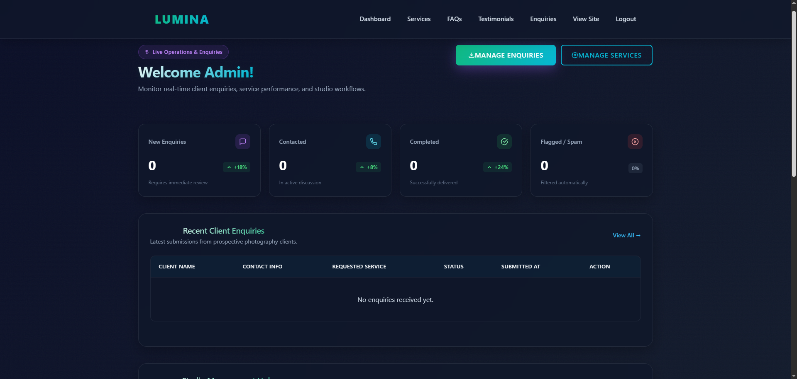

# LUMINA — Cinematic Photography Studio

A Flask-powered photography studio website featuring an immersive cinematic frontend, client enquiry system, and a dedicated admin dashboard for managing studio content and enquiries.

**Live Website:** [Kristoff.pythonanywhere.com](https://Kristoff.pythonanywhere.com)  
**Source Code:** [GitHub Repository](https://github.com/Kristoff-iwnl/lumina-studio)

---

## Preview

### Homepage


### Gallery

A closer look at the website's visual design and interface.










### Admin Dashboard



---

## Features

- **Cinematic Frontend:** Immersive visual experience with interactive scrolling and video backgrounds.
- **Alternative Classic Frontend:** A more traditional photography studio website layout.
- **Client Enquiry System:** Contact and enquiry submissions with honeypot protection, time-trap validation, and rate limiting.
- **Admin Authentication:** Dedicated admin login with session-based authentication.
- **Admin Dashboard:** Manage enquiries, services, FAQs, and testimonials.
- **Dashboard Insights:** Enquiry statistics, recent submissions, and management overview.
- **Security:** CSRF protection, Content Security Policy, secure cookie settings, and HTTP security headers.
- **Email Notifications:** Optional email notifications for new enquiries.

---

## Tech Stack

| Layer | Technologies |
|---|---|
| Backend | Python 3.12, Flask 2.3.3 |
| Database | SQLite, Flask-SQLAlchemy |
| Migrations | Flask-Migrate |
| Authentication | Flask-Login |
| Security | Flask-WTF, Flask-Limiter |
| Frontend | HTML5, CSS3, Vanilla JavaScript |
| Testing | Pytest |

---

## Run Locally

### 1. Clone the repository

```bash
git clone https://github.com/Kristoff-iwnl/lumina-studio.git
cd lumina-studio
```

### 2. Create a virtual environment

```bash
python -m venv venv
```

Activate it:

**Windows**
```bash
venv\Scripts\activate
```

**macOS / Linux**
```bash
source venv/bin/activate
```

### 3. Install dependencies

```bash
pip install -r lumina/requirements.txt
pip install -r lumina/requirements-dev.txt
```

### 4. Configure the application

Set the required environment variables before running the application.

At minimum, configure a secure `SECRET_KEY` for production and set `APP_ENV` appropriately.

### 5. Initialize the database

```bash
cd lumina
flask --app wsgi db upgrade
```

### 6. Create an admin account

```bash
flask --app wsgi create-admin
```

Follow the prompts to create your own admin credentials.

### 7. Start the application

```bash
python wsgi.py
```

Open the website at:

[http://127.0.0.1:5000](http://127.0.0.1:5000)

---

## Testing

Run the automated test suite from the repository root:

```bash
pytest lumina/tests/
```

---

## Deployment Documentation

Additional deployment and maintenance guides are available in the `docs/` directory:

- [PythonAnywhere Deployment](docs/DEPLOY_PYTHONANYWHERE.md)
- [Render Deployment](docs/DEPLOY_RENDER.md)
- [Pre-Deployment Checklist](docs/PRE_DEPLOY_CHECKLIST.md)
- [SQLite Backup & Restore](docs/BACKUP.md)

---

## Project Structure

```text
lumina-studio/
├── docs/
│   ├── gallery/
│   ├── home.png
│   ├── admin-dashboard.png
│   └── deployment guides
├── lumina/
│   ├── app/
│   ├── config/
│   ├── instance/
│   ├── migrations/
│   ├── tests/
│   ├── requirements.txt
│   └── wsgi.py
└── README.md
```

---

## Notes

- The live website is a demonstration deployment.
- Admin access requires credentials created by the administrator.
- Never commit production secrets, database credentials, or private configuration files to the repository.
- For production deployments, use a persistent database and configure environment variables securely.

---

## Credits

- Fonts: Ogg Text and Inter
- Visual assets and icons: Figma and CloudFront CDN
- Frontend implementation: Custom HTML, CSS, and JavaScript
